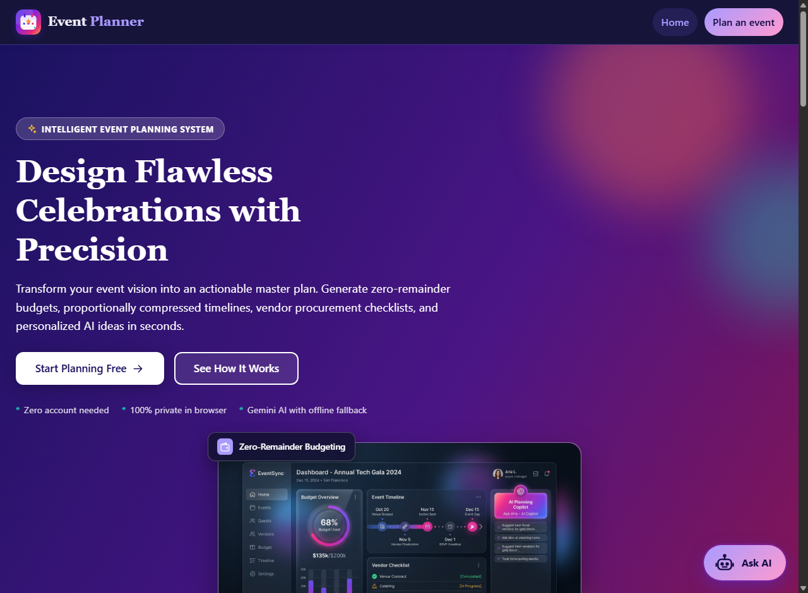

# Event Planner


Organising a celebration means juggling money, dates, suppliers and a hundred small decisions, and it is easy for something important to be forgotten until it is too late. Event Planner turns what you know about your event (its type, date, guest count and budget) into a plan you can follow from the first idea to the final thank-you note.

It is built for people planning their own wedding, birthday or community event who want clear guidance without hiring a planner or maintaining spreadsheets. It adapts to the number of guests, the size of the budget and the time left, and it works with or without an AI key: an optional Google Gemini assistant adds fresh ideas and answers, and a built-in planner keeps every feature working when the AI is not available.

**The challenge it addresses:** a GenAI-powered planning assistant that helps users organise weddings, birthdays and community events with budgets, timelines, vendor checklists and personalised ideas.

- **Live Demo:** [https://event-planner-rosy-three.vercel.app](https://event-planner-rosy-three.vercel.app)
- **GitHub Repository:** [https://github.com/yuvraj4176/event-planner](https://github.com/yuvraj4176/event-planner)




## How it works

1. **Describe your event.** On the Plan an event page, choose a wedding, birthday or community event, then enter its name, date, guest count, currency and total budget. Optionally add a city, a theme, interests and up to three budget priorities.
2. **The server builds your plan.** It validates every field, then creates the budget, timeline, vendor checklist and ideas with plain, tested functions. Nothing about your event is stored on the server.
3. **Review and track.** The plan appears in tabs. Tick off tasks and vendor steps, enter what you spend, and watch your progress. Everything is saved in your own browser.
4. **Ask and refine.** The floating chat assistant, "Ask the planner" and "Generate ideas with AI" call Google Gemini. If a model is out of quota or unavailable, the next model answers; if none can, the built-in planner does. Every answer says where it came from.
5. **Share.** Print the plan as a checklist or download it as a text file.


## Key features

### Budget
- Splits your total across categories such as venue, food, decor and entertainment, and always adds up exactly.
- Keeps a protected reserve for surprises.
- Lets you choose up to three priorities that receive a larger share.
- Tracks spending per category and says in words when a category is over budget.

### Timeline
- Counts tasks back from your event date, grouped into phases from early planning to after the event.
- Compresses automatically, and tells you so, when the event is closer than the recommended lead time.
- Shows due dates and status, such as "Due in 5 days" or "Overdue by 2 days".

### Vendor checklist
- Lists each vendor with its budget and a booking deadline, ordered by lead time.
- Gives four standard steps per vendor and specific questions to ask.
- Marks essential vendors and your priorities.

### Personalised ideas
- Ranks ideas by your theme and interests, and filters them by guest count and budget level.
- Shows which of your words matched each idea.
- Can generate fresh ideas with Gemini.

### Chat assistant
- A floating button on every page opens a chat window with an assistant that knows your saved plan.
- Uses Google Gemini and switches to the next configured model when one is exhausted, overloaded or retired, so it keeps working.
- Falls back to a built-in assistant when no model is available.
- Remembers the conversation while the tab is open.

### Print and download
- A dedicated print sheet with a banner, your details as points, a budget table, and checklists for tasks, vendor steps, questions and ideas, with finished items ticked.
- A text download with the same content, laid out as points and checklists.

### Privacy, security and accessibility
- No account, and plans are stored only in your browser.
- Strict security headers, host and origin checks, input validation, rate limiting and safe rendering of all text.
- Keyboard and screen reader support, visible focus, tested colour contrast, light and dark modes, high contrast and reduced motion support.

### Performance
- No runtime dependencies and no build step.
- Files are served from memory, compressed with Brotli or gzip and cached with ETags.

## Technology stack

| Layer | Technology |
| --- | --- |
| Server | Node.js 22 or later, using only the built-in `http`, `zlib`, `crypto` and `fs` modules |
| Browser | HTML, CSS and plain ES modules, with no framework and no build step |
| AI | Google Gemini API (`generateContent`) with ordered model failover |
| Storage | The browser's local storage (plan and progress) and session storage (chat) |
| Testing | The built-in Node.js test runner, `node:assert` and built-in coverage |
| Quality tools | A small dependency-free linter in `scripts/lint.js` and GitHub Actions for continuous integration |

## Getting started

You need Node.js 22 or later. There is nothing to install.

```bash
npm start
```

Open http://127.0.0.1:3000. The site has two pages that share one header and footer: Home (`/`) and Plan an event (`/plan.html`).

```bash
npm run dev       # restart automatically when files change
npm test          # run all tests
npm run lint      # check for dead code and common mistakes
npm run coverage  # tests with a coverage report and thresholds
npm run check     # lint, a syntax check and the tests
```

### Adding your Gemini API key

Create a key at https://aistudio.google.com/apikey, then copy `.env.example` to `.env` in the project folder and set:

```
GEMINI_API_KEY=your-key-here
```

Restart the server. The `.env` file is read at startup and is ignored by git. You can also set `GEMINI_API_KEY` as an ordinary environment variable, which takes priority. The chat window shows "Powered by Gemini" when the key works and "Basic mode" when it does not. The key is only used by the server and is never logged, put in a URL or sent to the browser.


### Deploying to Vercel

The project is ready for Vercel: the pages in `public/` are served by Vercel and the API runs as serverless functions in `api/`, with settings in `vercel.json`. Import the repository, add `GEMINI_API_KEY` as an environment variable, and deploy. See [docs/DEPLOYMENT.md](docs/DEPLOYMENT.md) for the steps.

## Folder structure

```
.
|-- server.js                 Entry point: reads settings, wires dependencies, starts listening
|-- package.json              Scripts only; no dependencies
|-- .env.example              Documented settings (copy to .env to add your key)
|-- README.md, CONTRIBUTING.md, SECURITY.md, LICENSE
|-- .github/workflows/ci.yml  Continuous integration: lint and tests on Node 22 and 24
|-- vercel.json, .vercelignore  Vercel settings: output folder, security headers, function time limit
|-- api/                      Vercel serverless functions: one file per API route, sharing _handler.js
|-- scripts/
|   `-- lint.js               Dependency-free linter
|-- src/                      The server
|   |-- app.js                HTTP server: routing, host checks, rate limits, compression, errors
|   |-- config.js, env.js     Settings with validation, and the git-ignored .env loader
|   |-- logger.js             Structured JSON logging
|   |-- http/                 Body reader, router, rate limiter, host guard, static files, security headers
|   |-- routes/api.js         API endpoints
|   |-- planner/              Pure planning logic: budget, timeline, vendors, ideas, validation
|   |   `-- data/             Event content for weddings, birthdays and community events
|   `-- ai/                   Gemini client with model failover, prompts, cache, AI and built-in service
|-- public/                   The website
|   |-- index.html            Home page: hero, about, how it works, features, FAQ
|   |-- plan.html             Plan an event page: form, plan and print sheet
|   |-- logo.svg, logo-mark.svg, favicon.svg
|   |-- dashboard-preview.jpg, event-types.jpg Visual assets
|   |-- css/                  styles.css, home.css, chatbot.css, print.css
|   `-- js/                   ES modules
|       |-- plannerPage.js    Page logic (main.js only connects it)
|       |-- views/            Budget, timeline, vendors, ideas, question and tab views
|       |-- chatbot.js        Floating chat assistant (with chatMessages.js and chatStore.js)
|       |-- planReport.js     One description of the plan for printing and downloading
|       |-- printSheet.js, exportText.js   Print sheet and text download
|       `-- api.js, store.js, progress.js, format.js, icons.js, ...
|-- tests/                    Automated tests, grouped by area
|   |-- planner/, ai/, http/, client/, quality/
|   |-- helpers/              Fake page, fixtures, test server and page harness
|   `-- server.test.js, entry.test.js, vercel.test.js, security.test.js
`-- docs/
    |-- ARCHITECTURE.md, SECURITY.md, ACCESSIBILITY.md, TESTING.md, DEPLOYMENT.md
    `-- screenshots/          Home.png preview of modern UI
```

## Evaluation criteria

| Criterion | How it is addressed | Where to look |
| --- | --- | --- |
| Code quality | Small single-purpose modules, none over 200 lines. Pure planning logic is separate from HTTP, AI and the page. Dependencies are passed in. A linter removes dead imports and exports. | `src/`, `public/js/`, `scripts/lint.js`, [docs/ARCHITECTURE.md](docs/ARCHITECTURE.md) |
| Security | Server-side validation, safe rendering (no `innerHTML`), strict content security policy, Host and Origin checks, rate limits, size limits, prompt-injection defences, dedicated security suite (`tests/security.test.js`), API key kept in the environment and sent only in a header, and no dependencies to patch. | [docs/SECURITY.md](docs/SECURITY.md), `src/http/`, `src/ai/`, `tests/security.test.js` |
| Efficiency | Files are served from memory with Brotli or async gzip and ETags, API answers are compressed without blocking the event loop, AI ideas are cached, model failover uses cooldowns and a time budget, and planning is a few hundred operations. | `src/http/staticFiles.js`, `src/ai/geminiClient.js`, `src/ai/cache.js` |
| Testing | 635 automated tests and about 99.9 percent line coverage, covering the planner, the server end to end, the Gemini client and failover, the page logic, accessibility rules, colour contrast, security attacks and project hygiene. | `tests/`, [docs/TESTING.md](docs/TESTING.md) |
| Accessibility | Landmarks, labelled controls, a linked error summary, ARIA tabs with keyboard support, visible focus, contrast checked by tests, light and dark modes, reduced motion and high contrast support, and no information shown by colour alone. | [docs/ACCESSIBILITY.md](docs/ACCESSIBILITY.md), `tests/quality/` |
| Problem statement alignment | Every requirement of the challenge is delivered. See the table below. | |

### Alignment with the problem statement

| Requirement | How it is delivered |
| --- | --- |
| Weddings, birthdays and community events | Three event definitions, each with its own budget split, timeline, vendors and ideas |
| Budgets | An exact category split with priorities, a protected reserve and a spending tracker |
| Timelines | A dated task list that adapts when the event is close |
| Vendor checklists | Booking deadlines, standard steps and questions to ask for each vendor |
| Personalised ideas | Ideas ranked by theme and interests and filtered by guests and budget |
| GenAI assistant | Gemini generates ideas, answers questions and powers a floating chat assistant, with model failover and a built-in fallback |

## Testing results


| Area | Folder | Tests | Result |
| --- | --- | --- | --- |
| Planner logic | `tests/planner` | 109 | Passed |
| Gemini client and AI service | `tests/ai` | 71 | Passed |
| HTTP units, host checks, client address and compression | `tests/http` | 57 | Passed |
| Server end to end, entry, Vercel functions, security suite | `tests/server.test.js`, `tests/entry.test.js`, `tests/vercel.test.js`, `tests/security.test.js` | 74 | Passed |
| Page logic, views, chat, print and download | `tests/client` | 167 | Passed |
| Accessibility, contrast, print, logo and hygiene | `tests/quality` | 157 | Passed |
| **Total** | | **635** | **All passed, 0 failed** |

| Coverage measure | Result | Threshold |
| --- | --- | --- |
| Lines | 99.88 percent | 95 percent |
| Branches | 98.68 percent | 90 percent |
| Functions | 99.78 percent | 95 percent |

The linter reports no problems. Run `npm run check` to reproduce these results. See [docs/TESTING.md](docs/TESTING.md) for what each group checks.

Not covered by automated tests, and checked by hand instead: behaviour that only a real browser has, such as the print dialog, focus handling in native dialogs and screen reader output.

## Future improvements

- **Accounts and sync.** Optional sign-in so a plan can follow you between devices and be shared with a partner or committee.
- **Collaboration.** Assign tasks to people, share a read-only link and add comments.
- **More event types.** Corporate events, anniversaries, baby showers and festivals, each with its own data file.
- **Guest management.** Guest list, RSVP tracking, dietary needs and a seating plan.
- **Real prices.** Optional regional price guidance, and quote tracking per vendor.
- **Reminders.** Calendar export and email or notification reminders for upcoming deadlines.
- **PDF export.** A generated PDF in addition to printing.
- **More languages.** Translated interface and content, and right-to-left layouts.
- **Smarter AI.** Let Gemini adjust the timeline and budget on request, and stream answers into the chat.
- **Installable app.** A web app manifest and offline support.
- **Wider browser testing.** Automated end-to-end tests in real browsers.

## Contributing and licence

See [CONTRIBUTING.md](CONTRIBUTING.md) to get started and [SECURITY.md](SECURITY.md) to report a vulnerability. Released under the MIT licence. See [LICENSE](LICENSE).
